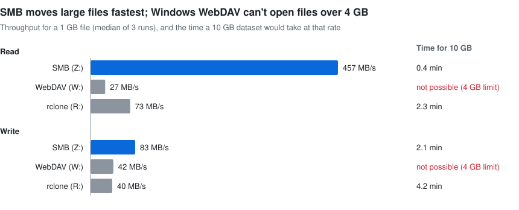
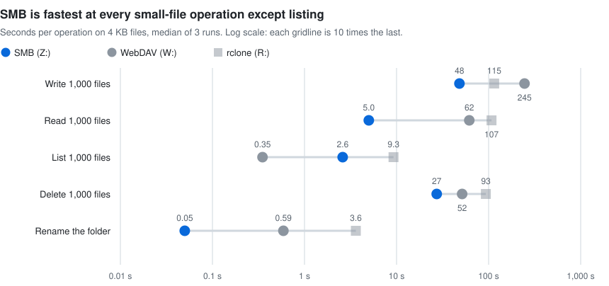

# EFS on Windows for SAS: SMB vs WebDAV vs rclone

**Use SMB.** In these tests SMB was the fastest way for a Windows client to
read and write shared storage at every operation but one, and the only one of
the three that handles a 10 GB SAS dataset with no caveats. Windows' built-in
WebDAV client **cannot open a file larger than 4 GB at all**. rclone can, but
it writes at half SMB's speed, signs in with a stored password, and stages
every file on the laptop's disk.

Tested 17–18 October 2026 on a fresh build of this repository. Raw output is
in [`results/`](results/).

## What was tested

One Windows client maps the same Amazon EFS folder three ways through one
Linux gateway, so the client and protocol are the only things that differ.

| Drive | Client | Protocol | Sign-in |
|---|---|---|---|
| `Z:` | Windows SMB client | SMB 3 to Samba, port 445 | AD single sign-on |
| `W:` | Windows WebDAV redirector (WebClient) | WebDAV over HTTPS to Apache `mod_dav`, port 443 | AD single sign-on (Kerberos) |
| `R:` | rclone 1.75 with WinFsp | the same WebDAV URL | username and password |

- **Hosts:** Windows Server 2022 client and Ubuntu 24.04 gateway, both
  `t3.medium`, in one VPC in `us-east-1`. The gateway mounts EFS (bursting
  throughput) over NFS with TLS.
- **[`benchmark.ps1`](benchmark.ps1):** 3 runs, median reported. One 1 GB
  file and 1,000 files of 4 KB are written, read, listed, renamed and deleted
  through each drive. Reads, listings and deletes always use files a
  *different* client wrote, so no client answers from its own cache. rclone
  uploads after a file closes, so its write times run until rclone has
  completed one upload per file.
- **[`bigfile.ps1`](bigfile.ps1):** one 5 GB file copied through each drive,
  each copy's SHA-256 checked on the server, and the first 10 MB of a 5 GB
  file read back.

## Large files: SMB is 2 to 17 times faster

<picture>
  <source media="(prefers-color-scheme: dark)" srcset="report-large-files-dark.svg">
  
</picture>

- **SMB reads fastest by far.** Part of its 457 MB/s is the gateway's
  memory: it had just written the file. A cold read is bounded by EFS and the
  network, so treat SMB's read figure as a best case. The other two clients
  read the same warm file and were still 6 to 17 times slower.
- **Windows' WebDAV client is slowest at reading (27 MB/s)** because it
  downloads the whole file into a local cache before Windows hands any of it
  to the application.
- **rclone reads at 73 MB/s, writes at 40 MB/s.** It fetches only the ranges
  read, which helps reads; it still writes the whole file locally first, then
  uploads it after the file closes, which is why its writes are no faster than
  Windows' WebDAV client.

## Files over 4 GB: only SMB and rclone work

One 5 GB file was copied through each drive, then checked on the server with
SHA-256 against the source ([`results/bigfile.txt`](results/bigfile.txt)):

| | Write 5 GB | Copy on the server | Read the first 10 MB of a 5 GB file |
|---|---|---|---|
| SMB (`Z:`) | 53 s (96 MB/s) | complete, checksum matches | not timed (SMB streams) |
| WebDAV, Windows client (`W:`) | **failed after 98 s**: "The parameter is incorrect" | **a 1 GiB fragment that doesn't match** | **refused**: "The file size exceeds the limit allowed and cannot be saved" |
| WebDAV, rclone (`R:`) | 136 s (38 MB/s), upload included | complete, checksum matches | 0.6 s, without fetching the rest |

- **Windows' WebDAV client fails twice over.** It can't open a file over
  4 GB, and a failed copy leaves a truncated fragment on the share, still
  under the client's WebDAV lock, so Windows can't clean it up.
- **rclone really does read ranges.** Apache's log for an earlier run showed
  it fetching 17 MB of the 5 GB file to serve a 10 MB read.

## Small files: SMB wins everything but listing

<picture>
  <source media="(prefers-color-scheme: dark)" srcset="report-small-files-dark.svg">
  
</picture>

- **Per file, SMB writes in 0.05 s; rclone takes 0.12 s and Windows' WebDAV
  client 0.25 s.** The WebDAV client sends about nine HTTP requests for each
  new file (check, create, lock, check, upload, set properties, unlock,
  check, plus a sign-in round trip).
- **rclone is the slowest reader of small files (0.11 s each)**, even
  though Apache's log shows one request per file: the time goes in the WinFsp
  driver and rclone's on-disk cache on the client.
- **Listing is the one win for WebDAV:** one request returns every name,
  size and time in the folder (0.35 s for 1,000 files). Samba checks each file
  on the NFS mount; rclone took 9.3 s through WinFsp.

SAS reads and writes large dataset files, so this chart matters less than the
first. It does matter for SAS libraries holding thousands of small datasets,
catalogs or indexes, and for directory scans when a `LIBNAME` is assigned.

## What this means for SAS

### Lifting 10 GB datasets into SASWORK and back

| | SMB (`Z:`) | WebDAV, Windows client (`W:`) | WebDAV, rclone (`R:`) |
|---|---|---|---|
| 10 GB dataset | works | **fails: 4 GB per-file limit** | works |
| Read 10 GB (lab rate) | about 0.4 min (warm cache) | not possible | about 2.3 min |
| Write 10 GB back (lab rate) | about 2.1 min | not possible | about 4.2 min, upload continues after SAS finishes |
| When SAS sees the first rows | at once (streamed) | after the whole file downloads | at once (ranges fetched as read) |
| Extra disk on the client | none | the whole file, on `C:` | the whole file on write, read ranges on read, on `C:` |
| Who owns the dataset on the server | the signed-in user | Apache's account (`www-data`) | Apache's account |

- **Partial reads favour SMB and rclone.** A `WHERE` clause that uses an
  index, or `OBS=`, reads only the pages it needs over SMB or rclone. Windows'
  WebDAV client downloads the whole file first, every time.
- **A finished DATA step isn't a saved dataset over rclone.** rclone uploads
  after the file closes, so SAS reports success while the upload is still
  running. In rclone's log from an earlier run on this lab, the upload took
  a further 12 to 34 seconds per GB after the file closed. A laptop that
  sleeps or disconnects in that window loses the write.
- **Per-user ownership exists only over SMB.** Over WebDAV, every dataset is
  owned by the web server's account, so server-side permissions can't tell
  users apart.

### Laptops over a VPN

The lab client sat next to the server. On a laptop, the user's connection
replaces the lab's network as the limit, and its upload speed is usually the
tightest. Moving one 10 GB dataset, best case, before VPN overhead:

| User's connection | Download | Upload |
|---|---|---|
| Home broadband, 100 down / 20 up Mbps | about 14 min | about 68 min |
| Good broadband, 300 down / 50 up Mbps | about 5 min | about 27 min |
| Office or fibre, 1 Gbps symmetric | about 1.5 min | about 1.5 min |

- **SMB needs the VPN.** Port 445 must never face the internet, and many ISPs
  block it. WebDAV's one advantage here is HTTPS on port 443, but Windows'
  client can't move these files, and rclone writes them at half SMB's speed.
- **Copy, then process.** Pull the dataset to the laptop with `robocopy /Z /J`
  (restartable, unbuffered), run SAS against the local copy, copy results back
  the same way. A dropped connection then costs a resumed copy, not a failed
  DATA step.
- **Or move SAS to the data.** Running SAS on Windows instances (or
  WorkSpaces, AppStream or a remote desktop) in the same VPC as the file
  server makes every lift a data-centre transfer, keeps the data off laptops,
  and needs only a few Mbps per user.

## Risks found in testing

Each of these was found while building and testing the lab; each is handled
in this repository's code.

| Finding | Effect | Handled by |
|---|---|---|
| Windows' WebDAV client caps files at 4 GB (50 MB by default) | large datasets can't be opened or saved | none possible on the client; use SMB or rclone |
| A failed WebDAV write leaves a truncated, locked file | a 1 GiB partial file on the share that Windows can't remove | manual cleanup on the server |
| Apache 2.4.53+ rejects request bodies over 1 GiB by default | every WebDAV client fails on uploads over 1 GiB | `LimitRequestBody 0` |
| rclone returns from close before uploading | SAS reports success before the data is on the server | wait for the upload; never close the laptop straight away |
| rclone's folder cache too short (1 s) | listing a 1,000-file folder never finishes | 30 s cache |
| Clients cache folder listings (SMB about 10 s, rclone 30 s) | a dataset written by one client is briefly invisible to another | wait before reading another client's new files |
| Deleting over WebDAV a file a Windows client has open over SMB | NFS leaves `.nfsXXXX` files; the folder won't delete | don't mix protocols on the same files |
| Samba's NetBIOS name must match its AD computer account | every SMB logon fails | `userdata.sh` sets it from the hostname |

## How production differs from the lab

The lab's absolute speeds come from small burstable instances and EFS.
Production replaces both, so rely on the lab's ratios and failure modes, not
its MB/s.

| | Lab | Production | Effect |
|---|---|---|---|
| File server | `t3.medium` in front of EFS (NFS) | `m6idn.12xlarge` serving ZFS directly | no NFS hop; the server stops being the bottleneck |
| Storage | EFS, bursting throughput | 3 × 16 TB io2 at 16,000 IOPS, striped | ceiling becomes the instance's EBS bandwidth (about 30 Gbps), if ZFS uses `recordsize=1M` |
| Server network | up to 5 Gbps, burstable | about 75 Gbps sustained | room for many users at once |
| One client connection | about 5 Gbps per-flow cap | the same cap inside AWS | one SMB session tops out near 600 MB/s; SMB Multichannel goes past it |
| Client | `t3.medium` in the VPC | laptops over a VPN | the user's link, latency and disk set the speed |

## Recommendation and next steps

1. **Standardise on SMB** to Samba on the ZFS server, over the VPN for
   laptops. Enable SMB Multichannel for clients inside AWS.
2. **Don't use Windows' built-in WebDAV client for SAS data.** The 4 GB limit
   rules it out for 10 GB datasets.
3. **Use rclone only where port 445 can't be opened**, and accept a stored
   password, half SMB's write speed and the upload-after-close risk.
4. **Prefer running SAS next to the data** over moving 10 GB datasets to
   laptops.
5. **Measure on real conditions before committing:** run `benchmark.ps1`
   from one laptop over the real VPN against the production server, with
   `-LargeMB 10240`.

## Reproducing these results

```bash
./apply.sh            # build (about 25 minutes)
./benchmark.sh        # 3 runs, about 55 minutes
./bigfile.sh          # 5 GB test, about 10 minutes
python3 make_report_charts.py results/benchmark.txt   # redraw the charts
./destroy.sh
```
